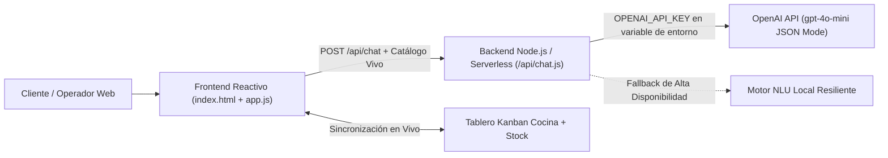

# 🔥 Don Brasa IA — Plataforma de Atención, Pedidos y Reservas Automatizadas con IA

> **Hackatón DonWeb Day Rosario 2026** — *"Del problema al servidor"*  
> **Rubro elegido:** Gastronomía Local (Bodegón & Pizzería Rosarina)  
> **Enfoque:** Catálogo en Tiempo Real + Concierge IA de Pedidos y Presupuestos + Transformador de Mensajes de WhatsApp a Comanda + Backoffice Kanban de Cocina y Reservas.

---

## 🎯 1. Diagnóstico del Problema
Un comercio gastronómico local tradicional atiende decenas de consultas, pedidos y reservas a mano por **WhatsApp y teléfono** en simultáneo durante la franja crítica (20:00 a 23:00 hs). Esto provoca:
1. **Demoras de 20 a 45 minutos** en responder cada mensaje de WhatsApp, perdiendo más del 35% de las ventas por abandono.
2. **Errores humanos de tipeo o interpretación de audios**, enviando productos equivocados o tomando direcciones incompletas.
3. **Desconexión entre quien atiende el teléfono y la cocina:** se siguen vendiendo platos que acaban de agotarse en el mostrador.
4. **Falta de venta sugerida (Upselling):** por apuro, el operador no ofrece bebidas, postres ni acompañamientos.

---

## 💡 2. Nuestra Solución: Don Brasa IA
Construimos una plataforma web integral donde la **Inteligencia Artificial está integrada en el corazón del flujo operativo**, conectando la experiencia del cliente con la cocina del local en tiempo real:

### A. Para el Cliente (Tienda + Concierge IA)
* **🤖 Asistente Conversacional BrasaIA (OpenAI `gpt-4o-mini` / `gpt-4o`):**
  * **Armado de Combos por Presupuesto y Restricciones:** El cliente escribe *"Somos 4 amigos, uno es vegetariano, queremos gastar menos de $36.000"* y la IA calcula matemáticamente la mejor combinación con platos en stock y genera una tarjeta interactiva para agregar todo el combo al carrito en **1 clic**.
  * **Toma de Pedidos con Acciones Directas (`autoCartAdd`):** Si el cliente escribe *"Mandame 1 pizza napolitana, 6 empanadas de carne a cuchillo y 1 limonada a Bv. Oroño 840"*, la IA interpreta los ítems, valida stock, suma los productos al carrito y autocompleta la dirección de entrega y medio de pago.
  * **Gestión de Reservas de Mesas:** Detecta solicitudes de reserva en lenguaje natural y las registra automáticamente en la agenda del local.
* **📲 Transformador de WhatsApp / Audio Transcripto a Comanda (1-Click):**
  * Permite pegar un mensaje largo y desordenado de WhatsApp para que la IA extraiga instantáneamente productos, cantidades, nombre, dirección, modalidad (*Delivery* o *Take Away*) y forma de pago.
* **✨ Upselling Inteligente en el Carrito:**
  * Sugiere automáticamente acompañamientos (ej. porción de fainá o bebida fresca) según la composición del carrito.

### B. Para el Comercio (Panel Operativo en Tiempo Real)
* **🔥 Tablero Kanban de Comandas (`Nuevos` → `En Cocina` → `En Camino`):**
  * Cada pedido confirmado desde la web o el asistente IA ingresa estructurado al tablero de cocina al instante.
* **📦 Control de Stock Sincronizado con el Contexto del LLM:**
  * Si el encargado marca un plato como **Agotado** en el panel de control, el prompt del asistente IA se actualiza en el acto: si un cliente intenta pedir ese plato por chat, la IA le avisa que se agotó en cocina y le ofrece el sustituto más cercano disponible.
* **📊 Métricas de Impacto Operativo (KPIs):**
  * Visualización en vivo de pedidos automatizados, facturación procesada, mesas reservadas y horas de trabajo humano ahorradas.

---

## 🏗️ 3. Arquitectura Técnica y Seguridad de la API Key



### 🔒 Protección de Credenciales (OpenAI API Key)
Siguiendo las buenas prácticas de seguridad exigidas en la hackatón:
* **La API Key NUNCA se sube al repositorio de GitHub.**
* El archivo `.env` está excluido mediante `.gitignore` (se provee únicamente `.env.example` como plantilla).
* En producción (Vercel / Render / Railway / DonWeb Cloud VPS), la clave se inyecta mediante la variable de entorno `OPENAI_API_KEY` o a través del modal seguro de configuración en caliente (`/api/config-key`).

---

## 🚀 4. Cómo Ejecutar y Desplegar

### Ejecución Local
1. Clonar el repositorio:
   ```bash
   git clone https://github.com/alebati123/Donwebday.git
   cd Donwebday
   ```
2. Copiar `.env.example` a `.env` y colocar la clave de OpenAI:
   ```env
   OPENAI_API_KEY=sk-proj-...
   OPENAI_MODEL=gpt-4o-mini
   PORT=3000
   ```
3. Iniciar el servidor (cero dependencias externas, arranca en milisegundos con Node.js nativo):
   ```bash
   node server.js
   ```
4. Abrir `http://localhost:3000` en el navegador.

### Despliegue en Cloud (Vercel / Render / Railway / DonWeb Cloud)
* **Vercel:** Importar el repositorio `alebati123/Donwebday` en Vercel, agregar la variable de entorno `OPENAI_API_KEY` y desplegar (detecta automáticamente `/api/chat.js` y `vercel.json`).
* **DonWeb Cloud Server / Render / Railway:** Comando de inicio `node server.js` con variable de entorno `OPENAI_API_KEY`.

---

## 🧪 5. Recorrido Sugerido para Evaluación del Jurado (2 Minutos)
1. **Probar el Concierge IA por Presupuesto:** En la *Vista Cliente*, hacer clic en el chip `"💰 Presupuesto $28.000 (3 pers.)"` o escribir `"Somos 4 amigos, uno vegetariano, tenemos $35.000"`. Luego presionar el botón verde **"🛒 Agregar todo este combo al carrito"**.
2. **Probar el Transformador de WhatsApp:** Ir a la pestaña `"📲 De WhatsApp a Pedido"`, elegir el *Ejemplo 1* y hacer clic en **"✨ Procesar con IA y Armar Pedido Automático"**.
3. **Comprobar la Sincronización de Stock con la IA:** Ir a `"📊 Panel del Negocio"`, marcar la *Pizza Napolitana Especial* como **AGOTADO**, volver al chat y escribir `"Quiero pedir una pizza napolitana"`. La IA detectará en vivo el quiebre de stock y sugerirá una alternativa disponible.
4. **Confirmar un Pedido:** En `"🛒 Mi Pedido"`, hacer clic en **"✅ Confirmar Pedido y Enviar a Cocina"** y observar cómo aparece inmediatamente en la columna `📥 Nuevos` del Tablero Kanban del comercio.

